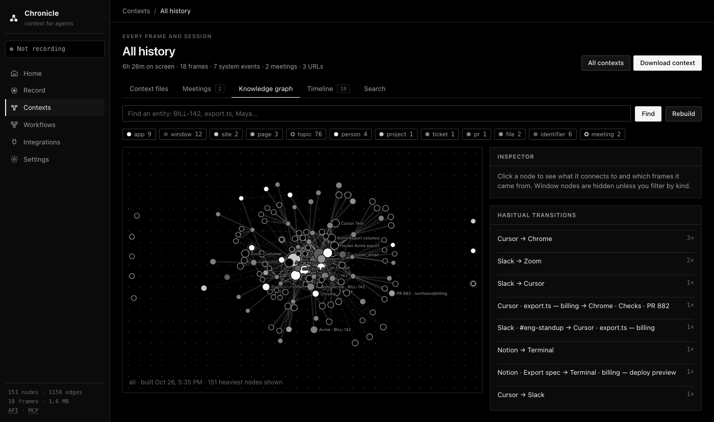

*The all-history knowledge graph for the synthetic sample workday that `chronicle demo` loads. No real screen data is shown.*

# Chronicle

<!-- mcp-name: io.github.aniketxdey/chronicle -->

Chronicle records your screen and system events, turns them into a knowledge graph, and serves that graph to LLM agents over MCP.

Agents usually start every task knowing nothing about your computer. They don't know which ticket you were on, which file you had open, or what you looked up ten minutes ago. So you end up pasting context in by hand. Chronicle keeps that memory locally and lets the agent ask for it:

- **Pick up where you left off.** "Finish the Acme export" works because the agent can see you were editing `export.ts`, that PR 882 is waiting on review, and what the export spec in Notion said.
- **Teach by showing.** Record yourself doing a task once, and the agent gets the apps, pages, and steps in order so it can repeat it.
- **Hand context to tools that don't speak MCP.** Export a recording as a Markdown context file, JSON, GraphML, or Cypher for ChatGPT or Claude Projects, NotebookLM, Neo4j, or a RAG pipeline.

Everything is stored in one local folder (`~/.chronicle`), with no account and no telemetry. The only data that leaves the machine goes to model providers you give a key to (see [Privacy](#privacy)).

## Quick start

Requires Python 3.10+. macOS is the main platform; Linux (X11) and Windows support is best effort.

```bash
uv tool install "chronicle-context[graph]"   # or: pipx install "chronicle-context[graph]"
chronicle demo                               # load a synthetic workday, so you can try it without recording
chronicle context "finish the Acme export"   # print what an agent would receive
chronicle mcp install cursor                 # or claude-desktop, claude-code, codex, vscode, gemini-cli, ...
```

`chronicle context` prints the same Markdown that the `get_context` MCP tool returns. On the sample workday it begins like this (trimmed):

```
# Computer context (Chronicle)
Task: finish the Acme export

## What you were doing
- 15:34-15:56 writing Acme Export spec · amount_usd (22m) [topic 1]
- 16:28-16:48 coding export.ts · amount_usd (20m) [topic 2]
- 16:50-17:02 coding Checks passed · Merge (12m) [topic 3]

## On screen now
- Chrome · Checks · PR 882 at Sun 16:50 (frame 18)
- URL: https://github.com/northwind/billing/actions
- Visible text: ... Merge is waiting on Priya's second review. Acme export is still due Friday.

## Knowledge graph (all)
- [topic] Acme export (`topic:acme-export`, 1h58m, frames 18, 16, 13)
- [pr] PR 882 (`pr:882`, 2h42m, frames 18, 17, 16)
- [file] export.ts (`file:export.ts`, 1h48m, frames 17, 11, 6)
- [person] Maya Chen (`person:maya-chen`, 2h28m, frames 16, 14, 12)
```

To record your own work, run `chronicle doctor` to check permissions, then `chronicle record 30m` or `chronicle serve` and use the UI at `http://127.0.0.1:3030`.

**Permissions and platform tools**

- **macOS:** grant Screen Recording and Accessibility, under System Settings › Privacy & Security, to whatever runs Chronicle: your terminal, or the MCP host app such as Claude Desktop or Cursor. Browser URLs need a one-time Automation prompt per browser. Supported browsers are Safari, Chrome, Arc, Brave, Edge, Vivaldi, and Opera.
- **Linux:** needs `xdotool` and `xprop`. For screenshots install one of `grim`, `gnome-screenshot`, `scrot`, or ImageMagick `import`. Add `xclip` or `wl-paste` for the clipboard and `xprintidle` for idle time.
- **Windows:** reads the window, idle time, screenshots, and clipboard through user32 and PowerShell.
- **OCR (optional):** `brew install tesseract` or `apt install tesseract-ocr`.

The only required dependencies are FastAPI and uvicorn. The `graph` extra adds scikit-learn and scipy for better duplicate merging, and `llm` adds the OpenAI SDK and python-dotenv.

## How it works

**Record.** A session runs for a set duration (`90s`, `30m`, `2h`) or until stopped. Every 5 seconds by default, the recorder samples the front app and window, the browser URL and tab title, and a screenshot. It also logs the system events `app_switch`, `window_focus`, `url_change`, `clipboard`, `idle_start`/`idle_end`, and `session_start`/`session_stop`. Screen text comes from the macOS Accessibility tree, and from `tesseract` OCR on the screenshot when an app exposes no text. Keystrokes are never recorded. Password managers, System Settings, and private browsing windows are skipped, and emails, API keys, JWTs, and card numbers are redacted before anything is written.

**Build the graph.** Each session gets its own graph shard. The shard is extended while recording and rebuilt once when the session ends, and frames captured outside a session go into hourly shards. The all-history graph is a SQL aggregation over the shards in which older shards count less (72-hour half-life by default). That keeps it focused on current work, and deleting a session just drops its shard.

- **Nodes:** apps, windows, sites, pages, search queries, topics, files, tickets (`BILL-142`), PRs, code identifiers, people, projects, customers, meetings, sessions, and tasks. Topics are keyphrases such as "Acme export", scored by frequency, spread, casing, position, and dwell time. Tasks are activity segmented by topic.
- **Edges:** `has_window`, `visited`, `on_site`, `shows`, `searched`, `about`, `co_occurs`, `switched_to` and `then` (workflow transitions), `spoke_in`, `discussed`, `copied`, `typed` (text pushed through `POST /add`), and `captured`.

Every node and edge records the time spent on it and the frames it came from, so an agent can cite its evidence. If an OpenAI key is available, a model also refines each recording when it ends (see [LLM refinement](#llm-refinement)).

**Serve.** `get_context(task)` returns a context pack with these parts:

- the current screen;
- recent activity blocks and system events;
- habitual app transitions;
- the subgraph relevant to the task;
- cited frames.

Agents then drill down with `query_graph`, `get_entity`, `search_history`, and `get_frame`, which can return the screenshot itself.

## Connect an agent

### Packaged installs

These need [uv](https://docs.astral.sh/uv/) on the `PATH`. Each runs `uvx chronicle-context mcp` and tells the model to call `get_context` before acting.

- **Claude Code, Claude Desktop, Cowork:** `claude plugin marketplace add aniketxdey/chronicle`, then `claude plugin install chronicle@chronicle`.
- **Gemini CLI:** `gemini extensions install https://github.com/aniketxdey/chronicle`.
- **MCP Registry clients:** search for `io.github.aniketxdey/chronicle`.

### Local clients (stdio)

`chronicle mcp install <client>` merges the server into the client's config and keeps a `.chronicle-backup` copy of the old file. `chronicle mcp config <client>` prints the snippet instead, and `chronicle mcp clients` lists them all.

| Client | Command | Config written |
| --- | --- | --- |
| Claude Desktop | `chronicle mcp install claude-desktop` | `claude_desktop_config.json` → `mcpServers` |
| Claude Code | `chronicle mcp install claude-code` | runs `claude mcp add --scope user chronicle -- …` |
| Cursor | `chronicle mcp install cursor` | `~/.cursor/mcp.json` |
| VS Code (Copilot agent mode) | `chronicle mcp install vscode` | user `mcp.json` → `servers` |
| Windsurf | `chronicle mcp install windsurf` | `~/.codeium/windsurf/mcp_config.json` |
| OpenAI Codex CLI | `chronicle mcp install codex` | `~/.codex/config.toml` → `[mcp_servers.chronicle]` |
| Gemini CLI | `chronicle mcp install gemini-cli` | `~/.gemini/settings.json` |
| Cline, LM Studio | `chronicle mcp install cline` / `lm-studio` | their `mcpServers` JSON |
| Zed, Continue, Goose | `chronicle mcp config zed` / `continue` / `goose` | paste the snippet |

For any other client:

```json
{ "mcpServers": { "chronicle": { "command": "chronicle", "args": ["mcp"] } } }
```

A stdio server can record on its own. Only one Chronicle process captures at a time: whichever holds `~/.chronicle/capture.lock`. So an agent can call `start_recording` without `chronicle serve` running. Pass `--no-record` to turn this off.

### Hosted agents and model APIs (Streamable HTTP)

`chronicle serve` exposes MCP at `POST /mcp` and supports protocol versions 2025-06-18, 2025-03-26, and 2024-11-05. Hosted agents need a public HTTPS URL, so put it behind a tunnel and set a token:

```bash
export CHRONICLE_TOKEN=$(openssl rand -hex 16)
export CHRONICLE_PUBLIC_URL=https://<your-tunnel-host>
chronicle serve &
cloudflared tunnel --url http://127.0.0.1:3030    # or ngrok, tailscale funnel
# MCP URL: $CHRONICLE_PUBLIC_URL/mcp/$CHRONICLE_TOKEN, or /mcp with "Authorization: Bearer $CHRONICLE_TOKEN"
```

With a token set, every route except the UI shell and `/health` requires it. Open the UI once with `?token=…` and it remembers the token. Requests with a non-local `Origin` header are rejected.

- **ChatGPT** (Settings › Connectors › Developer mode › Create): paste the `/mcp/<token>` URL with no authentication. The `search` and `fetch` tools return the shapes that connectors and deep research expect.
- **OpenAI Responses API:** `tools=[{"type": "mcp", "server_label": "chronicle", "server_url": URL, "require_approval": "never"}]`. See [`examples/openai_responses.py`](https://github.com/aniketxdey/chronicle/blob/main/examples/openai_responses.py).
- **Anthropic Messages API** (MCP connector beta `mcp-client-2025-04-04`): `mcp_servers=[{"type": "url", "url": URL, "name": "chronicle"}]`, alongside the computer-use tool. See [`examples/anthropic_computer_use.py`](https://github.com/aniketxdey/chronicle/blob/main/examples/anthropic_computer_use.py).
- **Gemini API** (`google-genai`): pass an MCP `ClientSession` connected to `chronicle mcp` as a tool. `chronicle mcp config gemini-api` prints the snippet.
- **Anything else:** `chronicle mcp config http` prints a `curl` call.

Provider model names and beta flags change often, so treat these snippets as starting points and check the provider's MCP docs.

## MCP tools

| Tool | What it does |
| --- | --- |
| `get_context` | Context pack for a task: current screen, recent activity and events, transitions, relevant subgraph, cited frames |
| `search_history` | Full-text search over screen text, events, transcripts, and memories |
| `query_graph` / `get_entity` / `graph_summary` | Find entities, walk their neighbors with evidence frames, and get counts and top transitions |
| `list_tasks` | Timeline of tasks, segmented from activity and grouped by topic |
| `get_frame` | One frame with nearby events and audio; `include_image=true` attaches the screenshot |
| `start_recording` / `stop_recording` / `list_sessions` | Let the agent record a demonstration for a set duration |
| `rebuild_graph` / `activity_summary` / `list_meetings` | Maintenance and summaries |
| `tune_graph` | Run the LLM refinement pass on a scope |
| `search` / `fetch` | ChatGPT connector and deep-research interface |

Resources: `chronicle://context/current`, `chronicle://graph/summary`, `chronicle://sessions`, and the templates `chronicle://context/session/{id}` and `chronicle://frame/{id}`.

Prompts: `use_my_computer_context(task)`, and `learn_from_recording(session_id)`, which turns a recorded demonstration into steps an agent can repeat:

```bash
chronicle record 5m --label "file an expense report"   # do the task once
chronicle context --session 1                          # check what the agent will see
```

Then ask the agent: *"Use the learn_from_recording prompt for session 1 and do it again for this receipt."*

## Web UI and REST API

`chronicle serve` runs the UI at `http://127.0.0.1:3030`:

- **Home:** recent recordings with their top apps, tasks, and topics, plus time per app over the last week.
- **Record:** start a timed recording and see what this machine can capture.
- **Contexts:** each recording, all history, or a new context generated from a task, time range, or recording. A context shows context files for eight kinds of work (general, data analysis, job applications, coding, research, writing, meeting follow-up, customer work), meetings, the knowledge graph, a timeline of frames and events, and search.
- **Workflows:** repeated loops found across recordings, and scheduled pipes.
- **Integrations:** MCP client setup and file exports.

The REST API is documented at `http://127.0.0.1:3030/docs`. The most useful routes:

| Route | Purpose |
| --- | --- |
| `POST /sessions {duration, label}` | Start a recording |
| `GET /context?task=&format=markdown` | The `get_context` pack |
| `GET /graph`, `GET /graph/node?id=` | Graph and single-node lookups |
| `GET /contexts/file?preset=…` | A context file, plus which model wrote it |
| `GET /contexts/export?format=md\|json\|graphml\|cypher` | Exports |
| `POST /add` | Push frames, events, or transcripts from your own capture, such as a Whisper audio pipeline |

## CLI

```
chronicle serve [--host --port]                       web UI, REST API, and HTTP MCP
chronicle record <duration> [--label --interval --detach]
chronicle stop [id] · chronicle sessions
chronicle graph build|show|find|node|export [--session N]   (build --full re-extracts every shard)
chronicle graph tasks [--session N --since "2h ago" --json]
chronicle graph merges [--session N --threshold --json]     (near-duplicate nodes the build merges)
chronicle graph tune [--session N --rounds 2 --force --reset]
chronicle context [task] [--minutes N --session N --json]
chronicle mcp [stdio|clients|config <client>|install <client> [--path --dry-run]]
chronicle search <q> · chronicle ask <question> · chronicle status · chronicle doctor · chronicle demo
```

## Configuration

| Variable | Default | Meaning |
| --- | --- | --- |
| `CHRONICLE_HOME` | `~/.chronicle` | Database, screenshots, pipes, and lock file |
| `CHRONICLE_TOKEN` | unset | Require this token on the HTTP API and MCP |
| `CHRONICLE_PUBLIC_URL` | `http://127.0.0.1:3030` | Base URL for links and remote client snippets |
| `CHRONICLE_DEMO=1` | off | Load the sample workday into an empty database on start |
| `CHRONICLE_DISABLE_CAPTURE=1` | off | Never record from this process |
| `CHRONICLE_HALF_LIFE_HOURS` | `72` | Decay half-life for the all-history graph; `0` or `off` disables it |
| `CHRONICLE_LLM` | unset (automatic) | `openai` or `off`. Unset means on whenever an OpenAI key is available |
| `CHRONICLE_LLM_MODEL` | `gpt-4.1-mini` | Model for graph refinement and context files |
| `OPENAI_API_KEY` / `OPENAI_BASE_URL` | unset / OpenAI | Credentials and endpoint for the `openai` provider |

Capture interval, idle threshold, screenshots, OCR, clipboard, redaction, and retention are settings, edited in the UI or through `POST /settings`. Two settings mirror environment variables: `graph_half_life_hours` overrides `CHRONICLE_HALF_LIFE_HOURS`, while `CHRONICLE_LLM` takes precedence over `llm_provider`.

## LLM refinement

The heuristic graph knows apps, pages, tickets, files, and identifiers, but it can't tell that "Crusoe" is a company or that a page is a job posting. When an OpenAI key is available, a model refines the graph and writes the context files. Without a key, Chronicle runs fully offline: the graph stays heuristic and context files are assembled from the recording directly.

```bash
uv tool install "chronicle-context[graph,llm]"
echo "OPENAI_API_KEY=sk-..." >> ~/.chronicle/.env
chronicle graph tune --session 1    # runs automatically when a recording ends
chronicle graph show --session 1    # activities and typed relations are listed first
```

The key can also come from the environment, a `.env` in the current directory, or an OpenAI key saved in Settings for Ask. A `.env` never overrides variables that are already set. Settings › LLM refinement or `CHRONICLE_LLM=off` turns refinement off. `GET /llm/status` reports the provider and model in use and the last error.

**Graph patches.** The model reads the heaviest nodes along with their evidence: window titles, URLs and search queries, redacted screen text, and dwell time. It replies through strict function calls: `add_entity`, `retype_node`, `rename_node`, `merge_nodes`, `add_relation`, `add_trait`, `set_activity`, and `drop_node`. `add_relation` supports `is_a`, `part_of`, `works_on`, `competes_with`, `located_in`, `researching`, `mentions`, `listed_in`, `uses`, and `related_to`.

- Each op is validated against the schema and the node ids that exist at that point. Rejected ops go back to the model in the next round. A run makes up to `--rounds` passes (default 2) and stops early when nothing new is proposed.
- Accepted ops are stored in `kg_llm_patches` and replayed after every rebuild, so refinement survives `graph build`. `--reset` removes them.
- Model-made nodes and edges carry `source: "llm"`, and relations carry a `confidence` and an evidence quote. `get_context` lists activities first, then relations such as `Crusoe —is_a→ company`.

**Context files.** For each of the eight presets, the model writes a document with the sections that kind of work needs and an "Open threads" list, citing frames. The evidence it was given is appended under "Recorded evidence".

**Caching and failures.**

- Responses are cached by a hash of the prompt and model, and a scope whose graph hasn't changed is skipped unless you pass `--force`.
- Rate limits, timeouts, and API errors are tried up to three times. An account with no credits fails on the first call.
- Errors are recorded in `last_llm_error` and never stop a recording. A failed context file falls back to the offline version.

Other providers can be added with `chronicle.llm.register(name, factory)`. A provider implements `call_tools(system, user, tools) -> [{"name", "arguments"}]` and `complete(system, user) -> str`.

## Privacy

Recordings, screenshots, and the graph stay in `CHRONICLE_HOME`. Data leaves the machine in three cases:

- **MCP clients:** an agent you connect receives the tool results it asks for.
- **LLM refinement:** when it's enabled, window titles, URLs, and redacted screen text are sent to OpenAI.
- **Ask:** `chronicle ask` and the Ask box send the matching history to the provider you configure in Settings.

[PRIVACY.md](https://github.com/aniketxdey/chronicle/blob/main/PRIVACY.md) has the details.

## Development

```bash
git clone https://github.com/aniketxdey/chronicle && cd chronicle
uv pip install -e ".[dev,graph,llm]"
pytest
python examples/stdio_client.py "finish the Acme export"
npx @modelcontextprotocol/inspector --cli chronicle mcp --method tools/list
```

| Module | Role |
| --- | --- |
| `chronicle/probe.py` | Reads the machine: windows, URLs, screenshots, Accessibility text, OCR |
| `capture.py`, `sessions.py` | The recorder and timed sessions |
| `graph.py` | Shard building, aggregation, and decay |
| `tuner.py`, `llm.py` | LLM patch pass and providers |
| `context.py`, `contexts.py` | Context packs and context files |
| `mcp_server.py`, `clients.py` | JSON-RPC core, stdio transport, and per-client setup |
| `main.py`, `web/` | HTTP server and UI |

Releases are described in [docs/PUBLISHING.md](https://github.com/aniketxdey/chronicle/blob/main/docs/PUBLISHING.md).

## License

MIT
